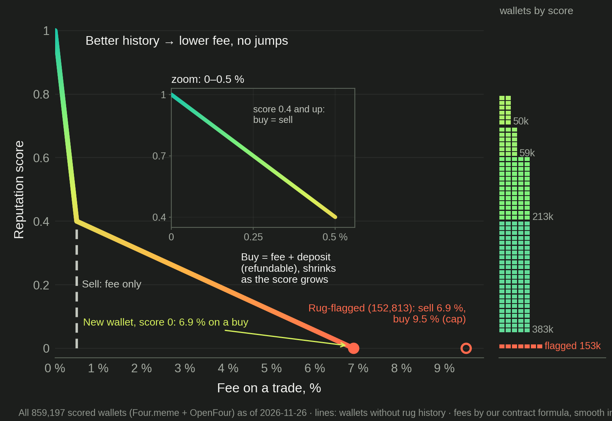
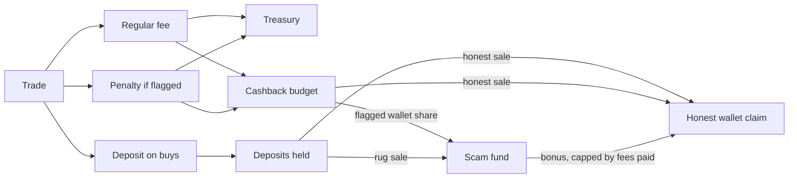
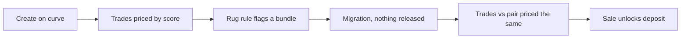

[中文说明](README.zh-CN.md)

# Proof of Reputation

For AI agents: [llms.txt](llms.txt) · [llms-full.txt](llms-full.txt)

Reputation-priced trading for OpenFour launches (Four.meme), built for **BNB Bangkok 2026 — Four.meme / OpenFour track**.

A wallet's on-chain track record sets its trading terms on every launch:
trusted traders pay less, low-score wallets pay a refundable deposit on buys that shrinks smoothly to zero at the neutral score, and wallets with a rug history pay a penalty proportional to their penalty component (no all-or-nothing cliff). Nobody is blocked: flagged wallets can buy and sell, sells are never blocked, and the sell-fee cap does not apply to flagged wallets.
OpenFour's protocol fee is untouched by construction.

*Fee by wallet score: buy = fee + refundable deposit, sell = fee; lines are for wallets without rug history. A flagged wallet pays up to 6.9 % on sells and is capped at 9.5 % on buys.*

### How the money flows

### Token lifecycle

**Site:** https://kox3ik.github.io/proof-of-reputation-openfour/ · **Demo video:** `site/media/demo.webm` (1:56) · **OpenFour submission:** [`docs/OPENFOUR_SUBMISSION.md`](docs/OPENFOUR_SUBMISSION.md) · **AI audit:** [`docs/AI-AUDIT.md`](docs/AI-AUDIT.md)

Status: hackathon submission, BSC testnet only (not audited by humans).

**Explainer video (1:38):** https://kox3ik.github.io/proof-of-reputation-openfour/media/explainer.webm

## Contracts

| Contract | Role |
| --- | --- |
| `ReputationRegistry` | Per-wallet score from 5 components (shown as 0-1; on chain the integers 0..1000) (volume, activity, holding, identity, penalty). Protocol-only weights and a smooth fee curve; config changes go through a delay. |
| `ReputationTradeModule` | OpenFour `TradeModule` (`evaluate(TradeContext)`): fee by score for every wallet (no buy ban; the flag penalty is part of the wallet's own rate; the sell cap does not apply to flagged wallets; sells are never blocked). Uses `tx.origin` when the trader is a contract. |
| `ReputationLockedToken` | OpenFour token implementation with a transfer fee before and after migration: wallet-to-wallet moves cost the sender's sell rate (to the treasury); trade flows are free, and so are router hand-offs of tokens bought in the same tx (see `docs/transfers.md`). |

### On-chain identity (BABT and Agent ID)

The `identity` component is `max(stored, babIdentity if BABT held, agentIdentity if Agent ID held)`. The checks are a
gas-capped (30k) `staticcall` to `balanceOf` that never reverts: a reverting, gas-burning, short-returning or
return-bombing token simply counts as "not held". Addresses live in the timelocked config and must be contracts.

The Agent ID is **not ERC-8004**. It is the ERC-721 "SPACE ID Agent ID" (OpenFour resolves it through its
AddressManager for the "Binance Agent ID Exclusive" preset 1778027615735).

| Token | BSC **mainnet** address | Testnet |
| --- | --- | --- |
| BABT (Binance Account Bound Token, SBT) | `0x2B09d47D550061f995A3b5C6F0Fd58005215D7c8` | not available; the local demo deploys mocks |
| SPACE ID Agent ID (ERC-721) | `0x60b9262456de011f7d15a54cdd8c48baaa8b022f` | not available; the local demo deploys mocks |

Deploy env vars: `BAB_TOKEN`, `AGENT_ID_TOKEN` (0 = check disabled), `BAB_IDENTITY` / `AGENT_IDENTITY` (default 700 / 500).

### Transfer fee (before and after migration)

A rug, as we define it, is "collect tokens by plain transfers onto one wallet, then sell in one trade". With
`ReputationLockedToken` bound to the preset (Registry `upsertTokenImpl` + the preset's `tokenImplId`), moving tokens
wallet-to-wallet, before or after migration, costs what selling from the sender would cost: `amount * quoteFeeBps(sender, false) / 10000`
in tokens, paid to the registry treasury, so a clean or warmed wallet gets no discount. Buys and sells through Core are free. A router handing
over tokens it bought in the same transaction is free, and a router pulling tokens from the signer for a sale is free only if it
is on the registry router allowlist (owner proposes, activates after `configDelay`); after migration, trades against the DEX pair are priced like curve trades, fee in tokens. Details and the
remaining hole: `docs/transfers.md`. OpenFour's own token bases target OpenZeppelin v4 hooks, so the fee is
expressed on OZ v5 `_update`; the interface/storage surface matches `OpenFourToken` (interfaces vendored in
`src/vendor/openfour`, MIT).

### Cashback

The on-chain path: OpenFour's post-trade hook calls `ReputationLedger`, which tracks positions and funds `CashbackPool`;
the deposit (charged on buys only) and cashback unlock only on a real sale, on the curve or into the migrated DEX pair (`docs/cashback.md`); migration itself releases nothing, and after migration the same pricing applies against the pair, fee in tokens (`docs/transfers.md`). Cashback is bucketed per (asset, token, wallet). The Merkle distributor is kept in the
repo but is not deployed.

**Scam fund.** A flagged wallet pays its usual fee plus a penalty, and its whole share of the pool goes into a separate fund, as do the deposit and cashback right confiscated from a rug sale. Honest wallets get their deposit back, their own cashback, and a bonus (the rest of the module fee they paid) from that fund; a plain claim pays the bonus only when the fund covers all bonus rights; otherwise the wallet itself can call `claimBonusPartial` to take a pro-rata share. Only what exceeds all bonus rights can be swept to the treasury. The penalty is live and proportional to the rug component: up to 640 bps on top of the regular rate, on buys and sells. Details: `docs/cashback.md`.

### Tests and demo

`forge test` (solc 0.8.24, via-IR): **283 passed**. Publisher: `cd service/publisher/tests && python3 -m unittest discover -p "test_*.py"`: **51 OK** (both measured 27 Nov 2026). Local end-to-end demo on a local fork of BSC testnet: `scripts/demo-local.sh`
(logs are written to `demo-out/`, including the full create, buy, sell, migrate, settle, claim path and the OpenFour submit pack built by `scripts/demo/make_submit_pack.js`). Real testnet: `scripts/demo-testnet.md`.

## Live on BSC Testnet (chain 97)

The final run (27 Nov 2026, ~02:19-02:32 BKK) is the deployment that counts: our own OpenFour fork plus our contracts, one simulation on a public chain. Addresses: `app/config.json`, `submission/reputation-bonding-registration.json`. Explorer: https://testnet.bscscan.com.

| Item | Address |
| --- | --- |
| ReputationRegistry | [`0x7231682cdfed6d9d401efb8a2002b026bcbbc105`](https://testnet.bscscan.com/address/0x7231682cdfed6d9d401efb8a2002b026bcbbc105) |
| ReputationTradeModule | [`0xd67a6d6F12d79495f2f0D8EDd1AD67cf9B73AcF4`](https://testnet.bscscan.com/address/0xd67a6d6F12d79495f2f0D8EDd1AD67cf9B73AcF4) |
| ReputationLedger | [`0x15B9f0b6Fd56c3622ae7E65C5d28D04efe888a54`](https://testnet.bscscan.com/address/0x15B9f0b6Fd56c3622ae7E65C5d28D04efe888a54) |
| CashbackPool | [`0x26c3fF93169be2049aaD92F732F013d015E70e75`](https://testnet.bscscan.com/address/0x26c3fF93169be2049aaD92F732F013d015E70e75) |
| ReputationLockedToken (impl) | [`0xbd5C281512b21927BbCAEcBfA34f63A8Ce4AB03D`](https://testnet.bscscan.com/address/0xbd5C281512b21927BbCAEcBfA34f63A8Ce4AB03D) |
| OpenFour fork Registry | [`0x74463FA010193012601912d961a445899164BeeF`](https://testnet.bscscan.com/address/0x74463FA010193012601912d961a445899164BeeF) |
| OpenFour fork Core | [`0x210edA86A5343b37a06573b6a4C9d49D0F86B2b3`](https://testnet.bscscan.com/address/0x210edA86A5343b37a06573b6a4C9d49D0F86B2b3) |
| Preset | `Reputation Bonding V1`, id `1795717041641` (tx [preset](https://testnet.bscscan.com/tx/0x0c4941f8e8720c11297cd22f0237295184271df0a6dd918291c7d71df1342a64)) |

The simulation: scores of 8,000 real mainnet wallets were loaded (800 with a rug history), 11 bot wallets traded three tokens, and the bundle that dumped was flagged 10 blocks (~4 s) after the dump.

Key transactions:

| Step | Tx |
| --- | --- |
| Honest first buy (fresh wallet, deposit charged) | [0x09d30f42...](https://testnet.bscscan.com/tx/0x09d30f4214a7eab1439c514c3492efac5baa5297a75f0b5f4c8106e545807833) |
| Bundle dump (bundle1; four wallets sold in block 145035168) | [0x5f2b384c...](https://testnet.bscscan.com/tx/0x5f2b384c74e585cd99165e57ec7b8c3fff3cdefe5b5b38b63b3ba50560ef42bb) |
| Flag publication by the publisher | [0x2e3d4e83...](https://testnet.bscscan.com/tx/0x2e3d4e83cc96d08290cf2a3c06560d5585ac46274d0f1597ffc2c588c8e3cd7d) |
| Bundle wallet buys BEFORE the flag: 50 bps | [0xfe2e3329...](https://testnet.bscscan.com/tx/0xfe2e332947180251e7ac34313ed44d0b4ae139ee1fd3b8631e185c060c91ddfd) |
| Same wallet buys AFTER the flag: 690 bps (50 + 640 penalty) | [0x5491c574...](https://testnet.bscscan.com/tx/0x5491c5747bc44b13d746992db7d81e4b0bb749f5a28d9c056489366cde637839) |
| Same wallet sells AFTER the flag: 690 bps, no sell cap | [0x96f17b72...](https://testnet.bscscan.com/tx/0x96f17b72315a8074bff1dc048c8f8e497e6b1180002a398f351fb642cad4258f) |
| Deposit and cashback forfeited (bundle1 / bundle2 / bundle3 / bundle4) | [1](https://testnet.bscscan.com/tx/0xe57bc3b5397390b8fe10bd0a8ca87b09f49bb471e4bfa2098dd9247a9978d771) / [2](https://testnet.bscscan.com/tx/0xaba3fd8c3932c8cd42467e9d54d4008dbbdeece52c3a44a3266ab7f1eb54e996) / [3](https://testnet.bscscan.com/tx/0xd7a7e35dafbee75add8017d7acf0e4c947b00db9a216a4a69f507c6964b05daa) / [4](https://testnet.bscscan.com/tx/0xaa2c1ce3e2cb401924788ae436e2b1812d383bcb61b3fd3277dc6f97bd9e45df) |
| Honest claim (deposit refund + cashback + bonus) | [honestA](https://testnet.bscscan.com/tx/0x9d8ab38f1d8461e432a8ebc6d09a2537354f304c6b7607ee9adbfb8f0034814c) |

Fees measured on chain (on top of OpenFour's 50 bps protocol fee, which is untouched): a wallet with a record pays 50 bps; a fresh wallet pays 690 bps on its first buy (50 regular + 640 refundable deposit); a flagged wallet pays 690 bps on buys and sells (50 + 640 penalty); the same bundle wallet went 50 -> 690 bps on buy and on sell once flagged. The complete log, with every hash: the run log referenced in `site/SOURCES.md` (`keyTxs`).

Not part of this final run: a migrate step (none was recorded). The migrate path was shown earlier on a local fork (`scripts/demo-local.sh`, `scripts/demo/migrate_flow.js`).

## Risks and limitations

- **Trusted keys.** One publisher key writes scores, flags and `coveredUntil`; the registry owner changes config (behind a timelock) and corrects flags. A wrong or malicious publication can unfairly flag a wallet or delay claims. Plan: multisig for the owner and the publisher, later a ZK proof of the publication.
- **Payer is `tx.origin`.** For a contract trader the module and ledger charge `tx.origin`. A relayer or ERC-4337 bundler is then the payer, not the user: positions mix and payouts go to the relayer.
- **Detector evasion.** The rug detector looks at wallets selling inside a 3-block window. Dumping through a collector contract, or stretching a dump over more than the window, is not detected. Sells in the first 60 s of a token are ignored.
- **Smooth pricing (current contracts).** Deposit on a buy = `freshDepositBps * (N - s) / N` (score `s`, knee `N` = `neutralScore`, 0 from the knee up); penalty = `penaltyBps * penaltyComponent / 1000`; regular + penalty + deposit is capped at 950 bps (the deposit is cut first; the penalty only if it alone exceeds the room). With the deploy defaults (regular 50 flat below the knee, deposit 640, penalty 640) the buy fee at score 0 / 100 / 200 / 300 / 400 / 700 is 690 / 530 / 370 / 210 / 50 / 25 bps without a penalty, and 950 / 950 / 950 / 850 / 690 / 665 bps with penalty component 1000. The per-wallet testnet measurements below predate this and show the old cliff.
- **Newness (informational only).** `isFresh` (no published trade yet) is shown in the UI but no longer prices anything: the deposit depends on the score only. A stricter threshold rule exists in the publisher (`service/publisher/newness.py`) but is off; its values are to be chosen by measurement. The Agent ID does not end newness; the BAB does.
- **Post-migration pricing is a prototype (in code and unit tests, not deployed).** It lives in the token's transfer hook, which cannot tell a swap from other moves of a V2 pair. Known gaps, found by our AI reviewers on 27 Nov: a plain transfer to the pair (then `skim`) or adding liquidity is treated as a sale and can unlock a deposit without a swap; removing liquidity is priced as a buy; only the registered migrated pair is priced (a second pool is not); a sale routed through a non-allowlisted contract (`user -> contract -> pair`) pays the sell rate on both hops; the publisher does not read DEX swaps yet. The production path is a PancakeSwap Infinity hook that sees the swap itself.
- **The rug component is binary today.** The contracts price the penalty continuously, but the reference rug rule in the publisher publishes 0 or 1000, so a wallet's sell fee still steps from 50 to 690 bps at the flag; a graded rug component is the next step.
- **Positions that never close.** Deposits and cashback unlock only on a real sale. A token that never migrates (for example one that ends in the Terminal phase) leaves open positions locked; the transfer fee still applies in that phase (`docs/transfers.md`). We have not tested Terminal behaviour against a real Core.
- **Token implementation.** `ReputationLockedToken` is built on OpenZeppelin v5; OpenFour's own `OpenFourToken` uses v4. It needs OpenFour's review before it can replace the official implementation.
- **Mock Core in unit tests.** The unit tests use a stand-in for OpenFour Core that pays the fee tiers before calling the ledger hook. The pool checks its balance on every report, so a different order would revert the trade instead of corrupting accounts. The demos and the publisher rehearsal run the same flow through OpenFour's Core deployed on a local fork of BSC testnet, which passes that check; nothing was run on an official, audited Registry.
- **Rehearsal needs a history snapshot.** `service/publisher/rehearse/rehearse.sh` (local anvil fork of BSC testnet, needs network and OpenFour's developer kit) uses a mainnet-history snapshot that is not in this repository; the publisher itself also starts without one (`--snapshot none`).
