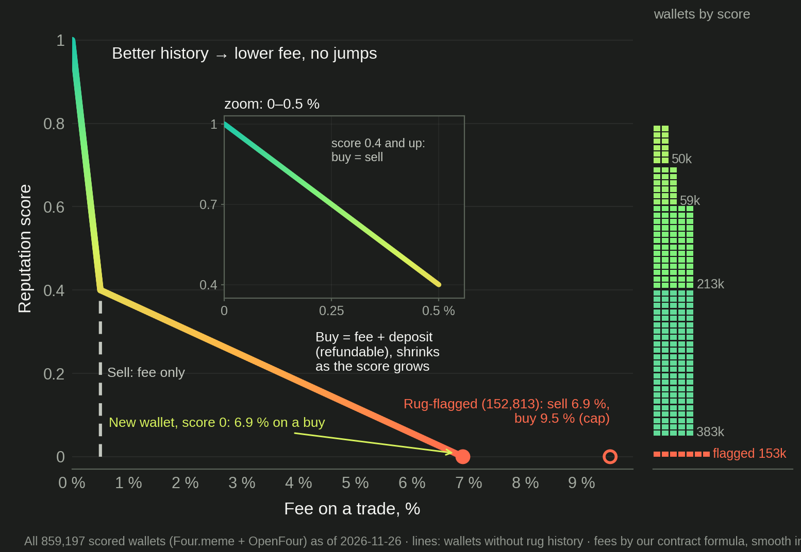
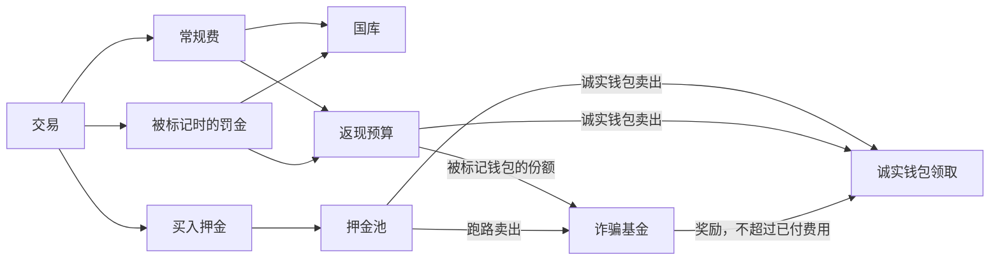

[English](README.md)

# Proof of Reputation

AI 代理版本：[llms.txt](llms.txt) · [llms-full.txt](llms-full.txt)

面向 OpenFour 发射（Four.meme）的信誉定价交易，为 **BNB Bangkok 2026 — Four.meme / OpenFour 赛道** 而建。

钱包的链上履历决定它在每次发射中的交易条件：
受信任的交易者费用更低；低分钱包在买入时缴纳可退还的押金，押金随分数平滑递减，到中性分数时降为零；有跑路（Rug）历史的钱包缴纳与其罚金分量成比例的罚金（没有“全有或全无”的断崖）。没有人被禁止：被标记的钱包仍可买入和卖出，卖出永远不会被阻止，且卖出费用上限不适用于被标记的钱包。
OpenFour 的协议费用在设计上保持不变。

*按钱包信誉分计算的费用：买入 = 手续费 + 可退还押金，卖出 = 手续费；曲线适用于无跑路记录的钱包。被标记的钱包卖出最高 6.9 %，买入上限 9.5 %。*

### 资金流向

### 代币生命周期

**网站：** https://kox3ik.github.io/proof-of-reputation-openfour/ · **演示视频：** `site/media/demo.webm`（1:56）· **OpenFour 提交材料：** [`docs/OPENFOUR_SUBMISSION.md`](docs/OPENFOUR_SUBMISSION.md) · **AI 审计：** [`docs/AI-AUDIT.md`](docs/AI-AUDIT.md)

状态：黑客松提交作品，仅限 BSC 测试网（未经人工审计）。

## 合约

| 合约 | 作用 |
| --- | --- |
| `ReputationRegistry` | 每个钱包由 5 个分量（交易量、活跃度、持仓、身份、罚金）构成的信誉分（显示为 0-1；链上为整数 0..1000）。权重仅协议可设，费率曲线平滑；配置变更需经过延迟。 |
| `ReputationTradeModule` | OpenFour `TradeModule`（`evaluate(TradeContext)`）：对每个钱包按信誉分定费（不禁止买入；标记罚金是钱包自身费率的一部分；卖出上限不适用于被标记的钱包；卖出永不被阻止）。当交易者是合约时使用 `tx.origin`。 |
| `ReputationLockedToken` | OpenFour 代币实现，迁移前后均收取转账费：钱包之间的转移按发送方的卖出费率收费（付给国库）；交易流转免费，同一笔交易中路由器交接所买入的代币也免费（见 `docs/transfers.md`）。 |

### 链上身份（BABT 与 Agent ID）

`identity` 分量为 `max(stored, babIdentity（若持有 BABT）, agentIdentity（若持有 Agent ID）)`。检查通过对 `balanceOf` 的限制 gas（30k）的 `staticcall` 完成，且绝不会回滚：回滚、耗尽 gas、返回数据过短或返回数据炸弹的代币，一律视为“未持有”。地址存放在带时间锁的配置中，且必须是合约。

Agent ID **不是 ERC-8004**。它是 ERC-721 的“SPACE ID Agent ID”（OpenFour 通过其 AddressManager 为“Binance Agent ID Exclusive”预设 1778027615735 解析它）。

| 代币 | BSC **主网** 地址 | 测试网 |
| --- | --- | --- |
| BABT（Binance Account Bound Token，SBT） | `0x2B09d47D550061f995A3b5C6F0Fd58005215D7c8` | 不可用；本地演示部署模拟合约 |
| SPACE ID Agent ID（ERC-721） | `0x60b9262456de011f7d15a54cdd8c48baaa8b022f` | 不可用；本地演示部署模拟合约 |

部署环境变量：`BAB_TOKEN`、`AGENT_ID_TOKEN`（0 = 关闭检查）、`BAB_IDENTITY` / `AGENT_IDENTITY`（默认 700 / 500）。

### 转账费（迁移前后）

按我们的定义，跑路是“通过普通转账把代币归集到同一个钱包，然后一笔交易全部卖出”。将 `ReputationLockedToken` 绑定到预设（Registry 的 `upsertTokenImpl` + 预设的 `tokenImplId`）后，无论迁移前后，钱包之间转移代币的成本等同于从发送方卖出的成本：以代币计 `amount * quoteFeeBps(sender, false) / 10000`，付给注册表国库，因此干净或已“养号”的钱包也得不到折扣。通过 Core 的买入和卖出免费。路由器在同一笔交易中交接其买入的代币免费；路由器为卖出而从签名者处拉取代币，仅当其在注册表路由器白名单上时才免费（由 owner 提议，经 `configDelay` 后生效）；迁移后，对 DEX 交易对的交易与联合曲线交易同样定价，费用以代币计。细节与仍存在的漏洞见 `docs/transfers.md`。OpenFour 自己的代币基类面向 OpenZeppelin v4 的钩子，因此该费用以 OZ v5 的 `_update` 表达；接口/存储布局与 `OpenFourToken` 一致（接口以 MIT 许可内置于 `src/vendor/openfour`）。

### 返现

链上路径：OpenFour 的交易后钩子调用 `ReputationLedger`，由其跟踪仓位并为 `CashbackPool` 注资；押金（仅在买入时收取）和返现只有在真实卖出（在联合曲线上，或卖入已迁移的 DEX 交易对）时才解锁（`docs/cashback.md`）；迁移本身不释放任何东西，迁移后同样的定价适用于该交易对，费用以代币计（`docs/transfers.md`）。返现按（资产、代币、钱包）分桶。Merkle 分发器保留在仓库中，但未部署。

**骗子基金。** 被标记的钱包除正常费用外还要付罚金，其在资金池中的全部份额进入一个独立基金，跑路卖出时被没收的押金和返现权也一并进入该基金。诚实钱包可取回押金、自己的返现，以及来自该基金的奖励（即其已缴模块费用的剩余部分）；普通领取仅在基金足以覆盖全部奖励权利时才发放奖励；否则钱包本人可调用 `claimBonusPartial` 按比例领取。只有超出全部奖励权利的部分才能划转到国库。罚金已生效，且与跑路分量成比例：在常规费率之上最高 640 bps，买入和卖出均适用。细节见 `docs/cashback.md`。

### 测试与演示

`forge test`（solc 0.8.24，via-IR）：**283 项通过**。发布器：`cd service/publisher/tests && python3 -m unittest discover -p "test_*.py"`：**51 项 OK**（均于 2026 年 11 月 27 日测得）。在 BSC 测试网的本地分叉上的本地端到端演示：`scripts/demo-local.sh`
（日志写入 `demo-out/`，包括完整的创建、买入、卖出、迁移、结算、领取路径，以及由 `scripts/demo/make_submit_pack.js` 构建的 OpenFour 提交包）。真实测试网：`scripts/demo-testnet.md`。

## 部署于 BSC 测试网（链 97）

最终运行（2026 年 11 月 27 日，曼谷时间约 02:19-02:32）是算数的部署：我们自己的 OpenFour 分叉加上我们的合约，在公链上做的一次模拟。地址见：`app/config.json`、`submission/reputation-bonding-registration.json`。浏览器：https://testnet.bscscan.com。

| 项目 | 地址 |
| --- | --- |
| ReputationRegistry | [`0x7231682cdfed6d9d401efb8a2002b026bcbbc105`](https://testnet.bscscan.com/address/0x7231682cdfed6d9d401efb8a2002b026bcbbc105) |
| ReputationTradeModule | [`0xd67a6d6F12d79495f2f0D8EDd1AD67cf9B73AcF4`](https://testnet.bscscan.com/address/0xd67a6d6F12d79495f2f0D8EDd1AD67cf9B73AcF4) |
| ReputationLedger | [`0x15B9f0b6Fd56c3622ae7E65C5d28D04efe888a54`](https://testnet.bscscan.com/address/0x15B9f0b6Fd56c3622ae7E65C5d28D04efe888a54) |
| CashbackPool | [`0x26c3fF93169be2049aaD92F732F013d015E70e75`](https://testnet.bscscan.com/address/0x26c3fF93169be2049aaD92F732F013d015E70e75) |
| ReputationLockedToken (impl) | [`0xbd5C281512b21927BbCAEcBfA34f63A8Ce4AB03D`](https://testnet.bscscan.com/address/0xbd5C281512b21927BbCAEcBfA34f63A8Ce4AB03D) |
| OpenFour fork Registry | [`0x74463FA010193012601912d961a445899164BeeF`](https://testnet.bscscan.com/address/0x74463FA010193012601912d961a445899164BeeF) |
| OpenFour fork Core | [`0x210edA86A5343b37a06573b6a4C9d49D0F86B2b3`](https://testnet.bscscan.com/address/0x210edA86A5343b37a06573b6a4C9d49D0F86B2b3) |
| 预设 | `Reputation Bonding V1`，id `1795717041641`（tx [preset](https://testnet.bscscan.com/tx/0x0c4941f8e8720c11297cd22f0237295184271df0a6dd918291c7d71df1342a64)） |

模拟内容：载入了 8,000 个真实主网钱包的信誉分（其中 800 个有跑路历史），11 个机器人钱包交易了三个代币，砸盘的捆绑钱包组在砸盘后 10 个区块（约 4 秒）被标记。

关键交易：

| 步骤 | Tx |
| --- | --- |
| 诚实钱包首次买入（新钱包，收取押金） | [0x09d30f42...](https://testnet.bscscan.com/tx/0x09d30f4214a7eab1439c514c3492efac5baa5297a75f0b5f4c8106e545807833) |
| 捆绑钱包砸盘（bundle1；四个钱包在区块 145035168 卖出） | [0x5f2b384c...](https://testnet.bscscan.com/tx/0x5f2b384c74e585cd99165e57ec7b8c3fff3cdefe5b5b38b63b3ba50560ef42bb) |
| 发布器发布标记 | [0x2e3d4e83...](https://testnet.bscscan.com/tx/0x2e3d4e83cc96d08290cf2a3c06560d5585ac46274d0f1597ffc2c588c8e3cd7d) |
| 捆绑钱包在标记前买入：50 bps | [0xfe2e3329...](https://testnet.bscscan.com/tx/0xfe2e332947180251e7ac34313ed44d0b4ae139ee1fd3b8631e185c060c91ddfd) |
| 同一钱包在标记后买入：690 bps（50 + 640 罚金） | [0x5491c574...](https://testnet.bscscan.com/tx/0x5491c5747bc44b13d746992db7d81e4b0bb749f5a28d9c056489366cde637839) |
| 同一钱包在标记后卖出：690 bps，无卖出上限 | [0x96f17b72...](https://testnet.bscscan.com/tx/0x96f17b72315a8074bff1dc048c8f8e497e6b1180002a398f351fb642cad4258f) |
| 押金和返现被没收（bundle1 / bundle2 / bundle3 / bundle4） | [1](https://testnet.bscscan.com/tx/0xe57bc3b5397390b8fe10bd0a8ca87b09f49bb471e4bfa2098dd9247a9978d771) / [2](https://testnet.bscscan.com/tx/0xaba3fd8c3932c8cd42467e9d54d4008dbbdeece52c3a44a3266ab7f1eb54e996) / [3](https://testnet.bscscan.com/tx/0xd7a7e35dafbee75add8017d7acf0e4c947b00db9a216a4a69f507c6964b05daa) / [4](https://testnet.bscscan.com/tx/0xaa2c1ce3e2cb401924788ae436e2b1812d383bcb61b3fd3277dc6f97bd9e45df) |
| 诚实钱包领取（退还押金 + 返现 + 奖励） | [honestA](https://testnet.bscscan.com/tx/0x9d8ab38f1d8461e432a8ebc6d09a2537354f304c6b7607ee9adbfb8f0034814c) |

链上实测费用（叠加在 OpenFour 的 50 bps 协议费用之上，协议费用不变）：有履历的钱包付 50 bps；新钱包首次买入付 690 bps（50 常规 + 640 可退还押金）；被标记的钱包在买入和卖出时付 690 bps（50 + 640 罚金）；同一个捆绑钱包被标记后，买入和卖出均由 50 升至 690 bps。包含每个哈希的完整日志：`site/SOURCES.md` 中引用的运行日志（`keyTxs`）。

不属于这次最终运行的内容：迁移步骤（未记录）。迁移路径此前已在本地分叉上展示（`scripts/demo-local.sh`、`scripts/demo/migrate_flow.js`）。

## 风险与局限

- **受信任的密钥。** 一个发布者密钥写入分数、标记和 `coveredUntil`；注册表 owner 修改配置（有时间锁）并纠正标记。错误或恶意的发布可能不公平地标记钱包或延迟领取。计划：owner 和发布者改用多签，之后引入发布内容的 ZK 证明。
- **付款方是 `tx.origin`。** 对合约交易者，模块和账本向 `tx.origin` 收费。此时付款方是中继者或 ERC-4337 bundler，而不是用户：仓位会混合，赔付会流向中继者。
- **检测器规避。** 跑路检测器观察 3 个区块窗口内卖出的钱包。通过归集合约砸盘，或把砸盘拉长到窗口之外，都不会被检测到。代币最初 60 秒内的卖出被忽略。
- **平滑定价（当前合约）。** 买入押金 = `freshDepositBps * (N - s) / N`（分数 `s`，拐点 `N` = `neutralScore`，拐点及以上为 0）；罚金 = `penaltyBps * penaltyComponent / 1000`；常规费 + 罚金 + 押金上限为 950 bps（先削减押金；仅当罚金本身就超出剩余空间时才削减罚金）。在部署默认值下（拐点以下常规费固定 50，押金 640，罚金 640），无罚金时分数 0 / 100 / 200 / 300 / 400 / 700 的买入费率为 690 / 530 / 370 / 210 / 50 / 25 bps；罚金分量为 1000 时为 950 / 950 / 950 / 850 / 690 / 665 bps。下文逐钱包的测试网实测早于此，显示的是旧的断崖规则。
- **新钱包判定（仅供参考）。** `isFresh`（尚无已发布的交易）会显示在界面中，但不再参与定价：押金只取决于分数。发布器中有一条更严格的阈值规则（`service/publisher/newness.py`），但处于关闭状态；其数值有待实测确定。Agent ID 不会终止新钱包状态，BAB 会。
- **永不平仓的仓位。** 押金和返现只在真实卖出时解锁。永不迁移的代币（例如停留在 Terminal 阶段的代币）会使未平仓位一直被锁定；该阶段仍会收取转账费（`docs/transfers.md`）。我们没有针对真实 Core 测试 Terminal 阶段的行为。
- **代币实现。** `ReputationLockedToken` 基于 OpenZeppelin v5 构建；OpenFour 自己的 `OpenFourToken` 使用 v4。需要经过 OpenFour 审查，才能取代官方实现。
- **单元测试中的模拟 Core。** 单元测试使用一个 OpenFour Core 的替身，它在调用账本钩子之前先支付费用档位。资金池在每次上报时检查其余额，因此顺序不同会使交易回滚，而不是破坏账目。演示和发布器演练在 BSC 测试网的本地分叉上，通过部署的 OpenFour Core 运行同样的流程，并通过了该检查；没有任何内容运行在官方的、经过审计的 Registry 上。
- **演练需要历史快照。** `service/publisher/rehearse/rehearse.sh`（BSC 测试网的本地 anvil 分叉，需要网络和 OpenFour 的开发者套件）使用一份不在本仓库中的主网历史快照；发布器本身在没有快照时也能启动（`--snapshot none`）。
